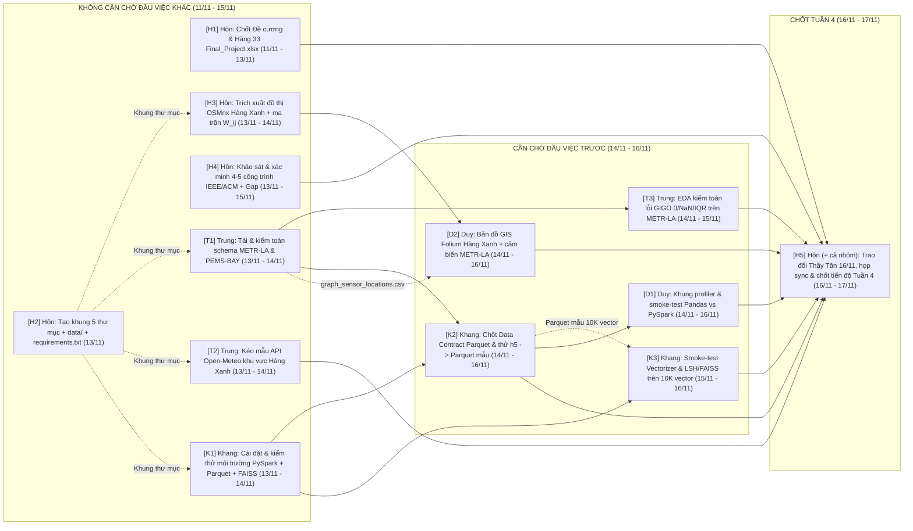

# KẾ HOẠCH THỰC HIỆN ĐỒ ÁN TUẦN 4 (11/11 – 17/11/2026)
## MÔN: PHÂN TÍCH DỮ LIỆU LỚN (`BIG DATA ANALYTICS`) — NHÓM 11

> **Khoảng thời gian:** Thứ Tư `11/11/2026` – Thứ Ba `17/11/2026` *(Tuần 4 — Fast-track Sprint; trọng tâm hoàn tất triển khai `13/11 – 17/11/2026`)*  
> **Giảng viên hướng dẫn:** TS. Hà Minh Tân *(Lịch học cố định: Chiều/Tối Thứ Hai hàng tuần — buổi kế tiếp: `16/11/2026`)*  
> **Tài liệu tham chiếu:** [De_Cuong_Chi_Tiet_Do_An_Phan_Tich_Du_Lieu_Lon.md](./De_Cuong_Chi_Tiet_Do_An_Phan_Tich_Du_Lieu_Lon.md) | [Ke_Hoach_Thuc_Hien_Do_An_Phan_Tich_Du_Lieu_Lon.xlsx](./Ke_Hoach_Thuc_Hien_Do_An_Phan_Tich_Du_Lieu_Lon.xlsx) | [README.md](./README.md) | [Final_Project.xlsx](../Final_Project.xlsx)  
> **Phạm vi tài liệu:** Chỉ liệt kê các đầu việc **thuộc Đồ án môn Phân tích dữ liệu lớn** của **4 thành viên Nhóm 11** trong Tuần 4; mỗi đầu việc ghi rõ **Đầu vào (Inputs)**, trạng thái **Chờ người khác hoàn thành**, **Sản phẩm bàn giao** và **lưu ý kỹ thuật** — đảm bảo đồ án vận hành độc lập 100%, chuẩn hóa cho pipeline **Apache Spark / PySpark + Parquet + LSH/ANN** và bám sát rubric `YeuCau` ($\ge 40$ trang báo cáo).  
> **Quy ước mã nguồn & dữ liệu lớn:** Các file `.py` khởi tạo trong Tuần 4 đóng vai trò module lõi để các notebook Colab / Spark Tuần 5–8 import trực tiếp. Tuyệt đối **không commit** file dữ liệu nhị phân dung lượng lớn (`.h5`, `.pkl`, `.parquet`, `data/raw/`, `data/interim/`) lên GitHub theo đúng [.gitignore](./.gitignore).

---

## I. SƠ ĐỒ PHỤ THUỘC ĐẦU VIỆC (AI LÀM LUÔN – AI CHỜ AI?)

---

## II. MA TRẬN PHỤ THUỘC TỔNG HỢP GIỮA 4 THÀNH VIÊN

| Thành viên | MSSV | Đầu việc làm được NGAY (Không chờ ai) | Đầu việc PHẢI CHỜ người khác | Vai trò mở khóa cho người sau |
| :--- | :---: | :--- | :--- | :--- |
| **Trần Hoàng Hôn** *(Trưởng nhóm / PM & Đồ thị TP.HCM)* | `26410046` | `[H1]`, `[H2]`, `[H3]`, `[H4]` | • `[H5]` (cần buổi học Thứ Hai `16/11` gặp Thầy Tân và đầy đủ sản phẩm `[K2]`, `[K3]`, `[T2]`, `[T3]`, `[D1]`, `[D2]` vào `16/11–17/11`) | **`[H2]` tạo bộ khung Repo** cho cả nhóm; **`[H3]` xuất `nodes.csv`/`edges.csv`/`adjacency_matrix.csv` Hàng Xanh** mở khóa `[D2]` cho Duy; **`[H4]`** làm nền viết Mở đầu & Chương 1 ở Tuần 5. |
| **Phạm Thành Trung** *(Kỹ sư Thu thập & Tiền xử lý GIGO)* | `26410141` | `[T1]`, `[T2]` | • `[T3]` (chờ `[T1]` của chính Trung tải xong `metr-la.h5`) | **`[T1]` là nút mở khóa lõi Big Data của tuần** — cung cấp `metr-la.h5` & `graph_sensor_locations.csv` cho Khang chạy `[K2]` và Duy gắn lớp kiểm chứng trên `[D2]`. |
| **Nguyễn Duy Khang** *(Kỹ sư PySpark & Thuật toán LSH/ANN)* | `26410055` | `[K1]` | • `[K2]` (**chờ `[T1]` của Trung** tải xong `metr-la.h5` + `[K1]` của chính Khang) • `[K3]` (viết khung sau `[K1]`; để test trên vector thật lấy mẫu Parquet từ `[K2]`) | **`[K2]` mở khóa định dạng `Parquet` chuẩn long-format** cho Duy chạy benchmark `[D1]` (`Pandas vs. PySpark`) và toàn bộ pipeline GIGO Tuần 5. |
| **Vũ Văn Duy** *(Kỹ sư Benchmark & Trực quan hóa)* | `26410031` | *(Viết trước khung đo `psutil`/`perf_counter` của `[D1]` trong khi chờ `[K2]`)* | • `[D1]` (chạy thực nghiệm lát cắt `100K–1M` dòng cần **chờ `[K2]` của Khang** xuất Parquet mẫu) • `[D2]` (**chờ `[H3]` của Hôn** xuất đồ thị Hàng Xanh + `[T1]` của Trung) | Xác nhận độ ổn định bộ khung đo `Wall-clock Time` / `Peak RAM` và kiểm chứng tọa độ thực địa Hàng Xanh tại phiên sync `[H5]`. |

---

## III. KẾ HOẠCH CHI TIẾT TỪNG THÀNH VIÊN (11/11 – 17/11/2026)

### 1. Trần Hoàng Hôn (`26410046`) — Trưởng nhóm / PM & Kiến trúc Đồ thị TP.HCM
*Định mức đồ án Phân tích dữ liệu lớn Tuần 4: ~2.5–3.0 giờ (bao gồm điều phối nhóm & trao đổi Thầy Tân tối Thứ Hai `16/11`)*

| Mã CV & Hạn | Đầu việc Đồ án | Đầu vào (Inputs) | Chờ người khác hoàn thành? | Sản phẩm bàn giao (Deliverables) |
| :--- | :--- | :--- | :--- | :--- |
| **`[H1]`** 11/11 – 13/11 | Rà soát, chốt Đề cương chi tiết & xác nhận đăng ký Hàng 33 trên file lớp | • [De_Cuong_Chi_Tiet_Do_An_Phan_Tich_Du_Lieu_Lon.md](./De_Cuong_Chi_Tiet_Do_An_Phan_Tich_Du_Lieu_Lon.md) & bản Word `.docx` • Hàng `33–36` trong [Final_Project.xlsx](../Final_Project.xlsx) | **Không cần chờ ai (Chốt rà soát cuối với 3 bạn qua Zalo).** *Lưu ý:* Đảm bảo 7 mục mô tả trên `Final_Project.xlsx` khớp 100% rubric sheet `YeuCau` (`> 40` trang báo cáo, Chương 2 `> 13` trang, Chương 3 `> 13` trang). | • Bản chốt `De_Cuong_Chi_Tiet_Do_An_Phan_Tich_Du_Lieu_Lon.docx` sẵn sàng trình **TS. Hà Minh Tân** + xác nhận trạng thái Hàng `33` trên `Final_Project.xlsx`. |
| **`[H2]`** 13/11 *(hoàn thành sớm trong ngày)* | Khởi tạo cấu trúc thư mục Repo & danh sách thư viện chuẩn Big Data | • Cấu trúc dữ liệu bỏ qua trong [.gitignore](./.gitignore) (`data/raw/`, `data/interim/`, `data/external/`) • Danh sách công nghệ tại Mục 3 & 6 của [De_Cuong_Chi_Tiet_Do_An_Phan_Tich_Du_Lieu_Lon.md](./De_Cuong_Chi_Tiet_Do_An_Phan_Tich_Du_Lieu_Lon.md) | **Không cần chờ ai (Làm ngay).** *Lưu ý kỹ thuật:* Tạo kèm file `.gitkeep` trong các thư mục rỗng và kiểm tra kỹ `requirements.txt` tương thích cả Local lẫn Google Colab (`pyspark`, `pyarrow`, `h5py`, `pandas`, `numpy`, `scipy`, `osmnx`, `networkx`, `folium`, `faiss-cpu`, `streamlit`, `psutil`). | • 5 thư mục code/tài liệu: `01_data_ingestion/`, `02_pyspark_gigo/`, `03_benchmarks_similarity/`, `04_hcm_dashboard/`, `05_report_slides/` + khung `data/{raw,interim,external}/` + `requirements.txt`. |
| **`[H3]`** 13/11 – 14/11 | Trích xuất đồ thị đường bộ cụm Hàng Xanh (`OSMnx`) & tính ma trận trọng số Gaussian $W_{ij}$ | • Tọa độ tâm Ngã tư Hàng Xanh `(10.8012, 106.7114)` (`dist=1000m`, `network_type='drive'`) • Công thức hàm nhân Gaussian $W_{ij} = \exp(-\text{dist}(v_i, v_j)^2 / \sigma^2)$ tại Mục I.3 của [De_Cuong_Chi_Tiet_Do_An_Phan_Tich_Du_Lieu_Lon.md](./De_Cuong_Chi_Tiet_Do_An_Phan_Tich_Du_Lieu_Lon.md#L106-L108) | **Không cần chờ ai** (chỉ cần thư mục `01_data_ingestion/` từ `[H2]`). *Lưu ý kỹ thuật & tối ưu liên môn:* Dùng `custom_filter` lọc 6 trục đường chính (XVNT, Đinh Bộ Lĩnh, Bạch Đằng, Điện Biên Phủ, Nguyễn Gia Trí/D2, Ung Văn Khiêm) để thu gọn đúng **`15–25` nút trọng điểm**. Có thể **đồng bộ bộ nút/tọa độ này** với đồ thị Hàng Xanh bên môn Máy học nâng cao (CS315) để giữ nhất quán cấu trúc dữ liệu, nhưng script vẫn chạy độc lập hoàn toàn trong `Đồ án/01_data_ingestion/`. | • Script `01_data_ingestion/extract_hang_xanh_graph.py` • `01_data_ingestion/hang_xanh_nodes.csv` (`15–25` nút), `hang_xanh_edges.csv`, `hang_xanh_adjacency_gaussian.csv` (ma trận $W_{ij}$), `hang_xanh.graphml`. |
| **`[H4]`** 13/11 – 15/11 | Khảo sát, xác minh trích dẫn 4–5 công trình chuẩn IEEE/ACM & tổng hợp `Research Gap` | • 4 nhóm tài liệu nền tảng tại Mục I.1 của [De_Cuong_Chi_Tiet_Do_An_Phan_Tich_Du_Lieu_Lon.md](./De_Cuong_Chi_Tiet_Do_An_Phan_Tich_Du_Lieu_Lon.md#L46-L58): Li et al. (2018) `METR-LA/PEMS-BAY`, Zaharia et al. (2016) `Apache Spark`, Indyk & Motwani (1998) `LSH` + Johnson et al. (2019) `FAISS`, Boeing (2017) `OSMnx` + nghiên cứu giao thông TP.HCM | **Không cần chờ ai.** *Lưu ý:* Kiểm tra đúng tên tác giả, năm, hội nghị/tạp chí, DOI và số liệu gốc của `METR-LA` / `PEMS-BAY` để làm khung viết **Mở đầu & Chương 1** ở Tuần 5 (đạt mục tiêu `8–10` trang chuẩn học thuật). | • `05_report_slides/literature_survey_notes.md` gồm danh mục BibTeX/IEEE chuẩn + bảng đối chiếu `Công trình – Phương pháp – Quy mô dữ liệu – Khoảng trống nghiên cứu (Research Gap)`. |
| **`[H5]`** 16/11 – 17/11 | Trao đổi **TS. Hà Minh Tân** buổi Thứ Hai `16/11`, điều phối họp sync nhóm & cập nhật tiến độ Tuần 4 | • Sản phẩm của `[T2]`, `[T3]`, `[K2]`, `[K3]`, `[D1]`, `[D2]` • [Ke_Hoach_Thuc_Hien_Do_An_Phan_Tich_Du_Lieu_Lon.xlsx](./Ke_Hoach_Thuc_Hien_Do_An_Phan_Tich_Du_Lieu_Lon.xlsx) & [Mau_Bao_Cao_Tuan_Phan_Tich_Du_Lieu_Lon.docx](./Mau_Bao_Cao_Tuan_Phan_Tich_Du_Lieu_Lon.docx) | **Chờ `[T3]`, `[K3]`, `[D1]`, `[D2]` hoàn thành** trước buổi sync `17/11`. *Cần hỏi/chốt với Thầy Tân tối `16/11`:* Xác nhận đề tài Nhóm 11 trên `Final_Project.xlsx` và phạm vi đối chứng `1M -> 17M` dòng (`METR-LA`/`PEMS-BAY`) + Case Study Hàng Xanh. | • `05_report_slides/bien_ban_gop_y_thay_tan_16_11.md` • Nhánh `main` GitHub hợp nhất đủ code Tuần 4 + cập nhật `%` Tuần 4 trong `Ke_Hoach_Thuc_Hien_Do_An_Phan_Tich_Du_Lieu_Lon.xlsx` + điền xong `Mau_Bao_Cao_Tuan_Phan_Tich_Du_Lieu_Lon.docx`. |

---

### 2. Phạm Thành Trung (`26410141`) — Kỹ sư Thu thập & Tiền xử lý GIGO
*Định mức đồ án Phân tích dữ liệu lớn Tuần 4: ~2.5–3.0 giờ*

| Mã CV & Hạn | Đầu việc Đồ án | Đầu vào (Inputs) | Chờ người khác hoàn thành? | Sản phẩm bàn giao (Deliverables) |
| :--- | :--- | :--- | :--- | :--- |
| **`[T1]`** 13/11 – 14/11 *(ưu tiên xong sớm mở khóa cho Khang & Duy)* | Tải bộ dữ liệu thực `METR-LA` & `PEMS-BAY` và viết script kiểm tra cấu trúc thô | • Nguồn công khai `DCRNN` (Li et al., 2018): `metr-la.h5`, `adj_mx.pkl`, `graph_sensor_locations.csv` (~7.1M điểm đo, 207 cảm biến) và `pems-bay.h5`, `adj_mx_bay.pkl` (~16.93M điểm đo, 325 cảm biến) • Thư mục `data/raw/` từ `[H2]` | **Không cần chờ ai** (chỉ chờ `[H2]` chốt đường dẫn `data/raw/` và `01_data_ingestion/`). *Lưu ý kỹ thuật:* Kiểm tra dung lượng đĩa (~150–250 MB cho 2 file `.h5`); tuyệt đối lưu trong `data/raw/` (đã nằm trong `.gitignore`), **không commit `.h5`/`.pkl` lên Git**. | • Dữ liệu thô lưu cục bộ tại `data/raw/metr-la.h5`, `data/raw/pems-bay.h5`, `data/raw/adj_mx*.pkl` • Script `01_data_ingestion/inspect_traffic_datasets.py` + `01_data_ingestion/graph_sensor_locations.csv` (file nhẹ, có thể đưa mẫu tọa độ lên repo) in ra shape, khoảng thời gian (`min/max timestamp`), kiểu dữ liệu và số nút/cạnh. |
| **`[T2]`** 13/11 – 14/11 | Xây dựng connector thu thập chuỗi thời gian thời tiết `Open-Meteo` khu vực TP.HCM | • Tọa độ tâm Hàng Xanh `(10.8012, 106.7114)` • API công khai `Open-Meteo` (`precipitation`, `temperature_2m`, `relative_humidity_2m`, `wind_speed_10m`, múi giờ `Asia/Ho_Chi_Minh`) | **Không cần chờ ai.** *Lưu ý tối ưu:* Giữ chuẩn tên cột `timestamp` (`UTC+7`, ISO-8601) và đơn vị đo giống quy ước dự án song song để sẵn sàng cho bài toán **Hồi quy OLS lượng mưa vs. vận tốc** ở Tuần 7. | • Script `01_data_ingestion/fetch_open_meteo.py` • `01_data_ingestion/open_meteo_hcm_sample.csv` (chuỗi dữ liệu mẫu nhiều ngày có cả ngày nắng và ngày mưa lớn phục vụ kiểm thử). |
| **`[T3]`** 14/11 – 15/11 | Chạy kiểm toán dữ liệu ban đầu (**GIGO Data Audit**) trên `METR-LA` (và mẫu `PEMS-BAY`) | • `data/raw/metr-la.h5` & `data/raw/pems-bay.h5` (từ `[T1]`) • Tiêu chí kiểm toán Mục I.1 & I.4 của [De_Cuong_Chi_Tiet_Do_An_Phan_Tich_Du_Lieu_Lon.md](./De_Cuong_Chi_Tiet_Do_An_Phan_Tich_Du_Lieu_Lon.md#L43) | **BẮT BUỘC CHỜ `[T1]` của chính Trung** tải xong `.h5`. *Lưu ý kỹ thuật:* Đo chính xác tỷ lệ giá trị `0.0` (*cảm biến mất tín hiệu*), tỷ lệ `NaN`, giá trị ngoại lai vượt ngưỡng vật lý (`< 0` hoặc `> 80 mph`) và phân bố theo khung giờ/cảm biến để làm số liệu chứng minh **KB1: Trước khi làm sạch GIGO**. | • Script `01_data_ingestion/gigo_data_audit.py` • Báo cáo `01_data_ingestion/gigo_audit_report.md` (kèm bảng thống kê % `0.0`, % `NaN`, phân vị $Q_1, Q_3, IQR$ dùng trực tiếp cho Chương 3). |

---

### 3. Nguyễn Duy Khang (`26410055`) — Kỹ sư Xử lý Phân tán (`PySpark`/`Parquet`) & Thuật toán Big Data (`LSH`/`ANN`)
*Định mức đồ án Phân tích dữ liệu lớn Tuần 4: ~2.5–3.0 giờ*

| Mã CV & Hạn | Đầu việc Đồ án | Đầu vào (Inputs) | Chờ người khác hoàn thành? | Sản phẩm bàn giao (Deliverables) |
| :--- | :--- | :--- | :--- | :--- |
| **`[K1]`** 13/11 – 14/11 | Thiết lập & kiểm thử môi trường **Apache Spark (`PySpark`) + `PyArrow/Parquet` + `FAISS`** | • `requirements.txt` từ `[H2]` • Yêu cầu hạ tầng Mục I.5 của [De_Cuong_Chi_Tiet_Do_An_Phan_Tich_Du_Lieu_Lon.md](./De_Cuong_Chi_Tiet_Do_An_Phan_Tich_Du_Lieu_Lon.md#L156) (Local CPU đa lõi / Google Colab) | **Không cần chờ ai (Làm ngay).** *Lưu ý kỹ thuật:* Kiểm tra phiên bản Java (`JDK 11/17`), cấu hình `spark.driver.memory`, `spark.sql.execution.arrow.pyspark.enabled=true`, nén `snappy` cho Parquet và xác nhận `faiss-cpu` import thành công. | • Script `02_pyspark_gigo/spark_env_check.py` (in phiên bản Spark, số lõi CPU, kiểm tra đọc/ghi thử DataFrame Parquet + test tạo `faiss.IndexFlatL2` thành công) + ghi chú cấu hình Colab/Local. |
| **`[K2]`** 14/11 – 16/11 | Thiết kế **Data Contract Parquet** & chạy thử chuyển đổi mẫu `METR-LA.h5 -> Parquet` phân vùng | • `data/raw/metr-la.h5` (từ `[T1]`) • Môi trường Spark đã thông (từ `[K1]`) | **BẮT BUỘC CHỜ `[T1]` của Trung** (lấy `metr-la.h5`) và `[K1]`. *Lưu ý kỹ thuật:* Chuyển bảng ma trận rộng `(34.272 x 207)` sang **bảng dài chuẩn Big Data (Long Format)** gồm `timestamp`, `sensor_id`, `speed`, `year_month`, `hour`, `day_of_week`; xuất `Parquet` phân vùng (*partitionBy*) theo `year_month` để phục vụ lát cắt `1M -> 5M -> 10M -> 17M` ở Tuần 6. | • `02_pyspark_gigo/parquet_schema_contract.md` (chốt tên cột, kiểu dữ liệu PySpark/Arrow, quy tắc partition) • Script `02_pyspark_gigo/h5_to_parquet_sample.py` xuất thành công `data/interim/metr_la_sample.parquet` (ít nhất `1M` dòng sạch cấu trúc) và đo thời gian/dung lượng nén so với `.h5`/`.csv`. |
| **`[K3]`** 15/11 – 16/11 | Xây dựng module Vectorizer cửa sổ trượt & smoke-test **`LSH` vs. `FAISS`** trên 10.000 vector mẫu | • Môi trường `PySpark` + `FAISS` (từ `[K1]`) • Mẫu `data/interim/metr_la_sample.parquet` (từ `[K2]`) | **Viết khung code sau `[K1]`; chạy kiểm thử trên vector `METR-LA` chờ `[K2]`.** *Lưu ý kỹ thuật:* Chuẩn bị vector cửa sổ trượt $W=12$ bước (60 phút $\times$ 207 cảm biến hoặc vector theo từng cảm biến $d=12..60$), kiểm tra hoạt động của `faiss.IndexFlatL2` (baseline Exact), `faiss.IndexHNSWFlat` và PySpark `BucketedRandomProjectionLSH` (hoặc `MinHashLSH`), xuất `Recall@10` & `Query Latency (ms)` mẫu. | • Script `03_benchmarks_similarity/smoke_test_lsh_faiss.py` chạy thông trên 10.000 vector, xác nhận API `FAISS` & `PySpark LSH` hoạt động ổn định làm nền cho thực nghiệm quy mô triệu vector ở Tuần 7. |

---

### 4. Vũ Văn Duy (`26410031`) — Kỹ sư Benchmark Hiệu năng & Trực quan hóa
*Định mức đồ án Phân tích dữ liệu lớn Tuần 4: ~2.5–3.0 giờ*

| Mã CV & Hạn | Đầu việc Đồ án | Đầu vào (Inputs) | Chờ người khác hoàn thành? | Sản phẩm bàn giao (Deliverables) |
| :--- | :--- | :--- | :--- | :--- |
| **`[D1]`** 14/11 – 16/11 | Xây dựng khung đo kiểm tài nguyên (`Benchmark Profiler`) & smoke-test `Pandas vs. PySpark` (`100K–1M` dòng) | • Bộ chỉ số đối chứng Mục I.2 & I.4 của [De_Cuong_Chi_Tiet_Do_An_Phan_Tich_Du_Lieu_Lon.md](./De_Cuong_Chi_Tiet_Do_An_Phan_Tich_Du_Lieu_Lon.md#L91) • `data/interim/metr_la_sample.parquet` (từ `[K2]`) | **Viết sẵn khung `benchmark_profiler.py` ngay từ `14/11`; chạy test trên dữ liệu thật CHỜ `[K2]` của Khang.** *Lưu ý kỹ thuật:* Bắt buộc đo **Peak RAM (MB)** theo tiến trình (`psutil.Process().memory_info().rss` hoặc `/proc` + `tracemalloc`), **Wall-clock Time (s)** bằng `time.perf_counter()`, và xuất log ra CSV chuẩn để Tuần 6 chạy thẳng các mốc `1M -> 5M -> 10M -> 17M` dòng vẽ biểu đồ cho Chương 3. | • Module `03_benchmarks_similarity/benchmark_profiler.py` • Script `03_benchmarks_similarity/smoke_test_pandas_vs_spark.py` chạy thử phép `Read + GroupBy + Rolling Mean` trên lát cắt `100K–1M` dòng và lưu mẫu `03_benchmarks_similarity/smoke_benchmark_results.csv`. |
| **`[D2]`** 14/11 – 16/11 | Dựng bản đồ GIS (`Folium`) kiểm chứng tọa độ nút giao Hàng Xanh & lớp cảm biến `METR-LA` | • `01_data_ingestion/hang_xanh_nodes.csv` & `hang_xanh_edges.csv` (từ `[H3]`) • `01_data_ingestion/graph_sensor_locations.csv` (từ `[T1]`) • Danh sách điểm hay ngập/nghẽn cụm Hàng Xanh (Đinh Bộ Lĩnh, XVNT gần cầu Bình Triệu, Ung Văn Khiêm) | **BẮT BUỘC CHỜ `[H3]` của Hôn** (đồ thị Hàng Xanh) và `[T1]` của Trung (tọa độ 207 cảm biến `METR-LA`). *Lưu ý kỹ thuật:* Xuất bản đồ 2 chế độ hoặc 2 tệp HTML tách biệt để vừa kiểm tra tọa độ thực địa Hàng Xanh cho Case Study TP.HCM, vừa hiển thị được cụm mạng lưới cảm biến benchmark `METR-LA` phục vụ giao diện **Web Dashboard (`Streamlit`)** Tuần 8. | • Script `04_hcm_dashboard/build_gis_inspection_map.py` • Bản đồ `04_hcm_dashboard/hang_xanh_gis_check.html` & `04_hcm_dashboard/metr_la_sensors_map.html` + ghi chú kiểm chứng tọa độ nút giao/chiều đường. |

---

## IV. CHECKLIST NGHIỆM THU TUẦN 4 (`DEFINITION OF DONE` — HẠN `17/11/2026`)

- [ ] **Hồ sơ & Trao đổi GVHD (`[H1]`, `[H2]`, `[H5]`):** Chốt `De_Cuong_Chi_Tiet_Do_An_Phan_Tich_Du_Lieu_Lon.docx`, xác nhận Hàng `33` trên [Final_Project.xlsx](../Final_Project.xlsx); khởi tạo đủ 5 thư mục code + `data/` + `requirements.txt`; trao đổi nhanh cùng **TS. Hà Minh Tân** buổi Thứ Hai `16/11` và lưu biên bản góp ý.
- [ ] **Dữ liệu Benchmark & Kiểm toán GIGO (`[T1]`, `[T2]`, `[T3]`):** Tải đủ `METR-LA` (~7.1M dòng) & `PEMS-BAY` (~16.93M dòng) vào `data/raw/` (không push Git); kéo mẫu `open_meteo_hcm_sample.csv` chuẩn `UTC+7`; hoàn thành `gigo_audit_report.md` định lượng rõ tỷ lệ giá trị `0.0`, `NaN` và ngoại lai IQR.
- [ ] **Đồ thị TP.HCM & Kiểm chứng GIS (`[H3]`, `[D2]`):** Xuất đủ `hang_xanh_nodes.csv` (`15–25` nút), `hang_xanh_edges.csv`, `hang_xanh_adjacency_gaussian.csv` (trọng số $W_{ij}$) và kiểm chứng trực quan trên `hang_xanh_gis_check.html` + `metr_la_sensors_map.html`.
- [ ] **Hạ tầng PySpark / Parquet & Smoke-test (`[K1]–[K3]`, `[D1]`):** Cài đặt thông `PySpark` + `PyArrow` + `FAISS`; chốt `parquet_schema_contract.md` và chuyển đổi thử thành công mẫu `METR-LA` sang `Parquet`; chạy thông `smoke_test_lsh_faiss.py` (`10K` vector) và `smoke_test_pandas_vs_spark.py` (`100K–1M` dòng) xuất `smoke_benchmark_results.csv`.
- [ ] **Khảo sát học thuật & Đồng bộ cuối tuần (`[H4]`, `[H5]`):** Hoàn thành `05_report_slides/literature_survey_notes.md` (trích dẫn chuẩn IEEE/ACM cho 4–5 công trình gốc + `Research Gap`); họp sync cả 4 thành viên `17/11`, hợp nhất nhánh `main`, điền [Mau_Bao_Cao_Tuan_Phan_Tich_Du_Lieu_Lon.docx](./Mau_Bao_Cao_Tuan_Phan_Tich_Du_Lieu_Lon.docx) và cập nhật `%` Tuần 4 trong [Ke_Hoach_Thuc_Hien_Do_An_Phan_Tich_Du_Lieu_Lon.xlsx](./Ke_Hoach_Thuc_Hien_Do_An_Phan_Tich_Du_Lieu_Lon.xlsx).

